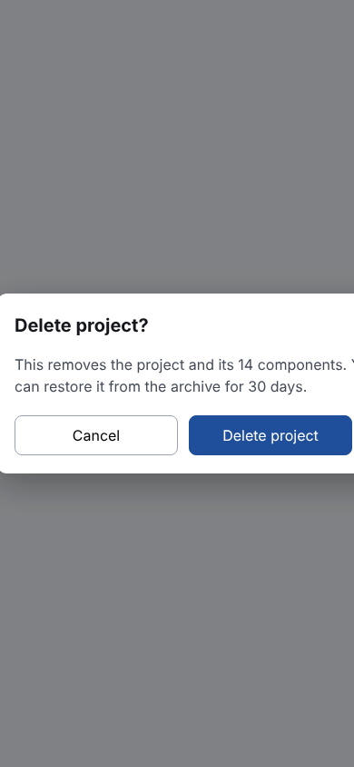

# Visual report: Dialog/Confirm (PROTOTYPE sample)

> Throwaway sample for ticket #6. A real run on a fixture (`../Dialog.html`) built with deliberate defects. Screenshots, axe-core results and measurements are real; the review text is what Claude wrote after looking at the four screenshots.

Run 2026-11-22 · 1 component · 1 story · Playwright (Chromium) · axe-core (WCAG 2.0 A and AA, 2.2 AA, best practice)

## Summary

| Story | Result | Blocking reasons |
| --- | --- | --- |
| `Dialog/Confirm` | **Failure** | 1 critical and 1 serious accessibility finding; clipped at 390px, 320px and 200% text |

Pixel diff: not run (no approved baseline yet). Threshold when a baseline exists: 0.1%, warning only.

## Screenshots

| Capture | Image | Page overflow (automated) | Dialog right edge vs viewport |
| --- | --- | --- | --- |
| 390×844 | [mobile](screenshots/dialog-confirm-mobile-390x844.png) | 0px | 448px vs 390px (58px clipped) |
| 1280×800 | [desktop](screenshots/dialog-confirm-desktop-1280x800.png) | 0px | 920px vs 1280px (fits) |
| 320px reflow | [reflow](screenshots/dialog-confirm-reflow-320.png) | 0px | 448px vs 320px (128px clipped) |
| 200% text at 390 | [text 200%](screenshots/dialog-confirm-text-200.png) | 0px | 448px vs 390px (58px clipped) |

## Visual review (Claude, from the screenshots)

Reviewed against the Dialog card (`../../component-cards/dialog.md`, branch `prototype/component-card`).

**Blocking**
1. **Dialog is cut off on the right at 390px, 320px and 200% text.** The body sentence is clipped mid-word ("You…"), the "Delete project" button runs to the screen edge, and at 320px its label reads "Delete pro". The close button is pushed off-screen, so it is not visible at all. The automated page-overflow check reported 0px because the dialog sits in a fixed overlay, so this was only caught by looking. Cause: the two 180px footer buttons set a minimum width wider than the screen. Card rule: no horizontal scroll or clipping at 320px; footer actions stack on mobile.
2. **Close button looks unfinished and is too small.** At 1280px it is a blank grey 20×20 square with no icon, below the 24×24px floor, and axe reports it has no name.

**Should fix**
3. **Body copy ignores the 200% text setting.** The heading grows, but the body paragraph stays the same size, so the text scale is only partly applied. Cause: the paragraph uses a fixed pixel size instead of a relative one.
4. **The destructive action does not look destructive.** "Delete project" uses the same blue as a normal primary action. For a destructive confirmation, the intent should show in the colour or the label, and focus should start on Cancel.

**Looks right**
- At 1280px the layout is balanced: title, body, and the two actions align, with clear spacing and readable contrast.
- The heading hierarchy and the body line length are fine at every size.

## Accessibility findings (axe-core, 390×844)

| Impact | Rule | Element | Fix |
| --- | --- | --- | --- |
| **Critical, blocks** | `button-name` | `.close` | Add an accessible name (`aria-label="Close"`) and a visible icon. |
| **Serious, blocks** | `aria-dialog-name` | `#confirm-dialog` | Name the dialog with `aria-labelledby` pointing at the title. |

serious and critical findings block the run. Moderate and minor would be listed here without blocking.

## Improvements

1. Let the dialog shrink to the viewport and stack the footer buttons below the mobile breakpoint.
2. Give the close button a name, an icon, and a target of at least 24×24px.
3. Size body text in relative units so it follows the text scale.
4. Use the destructive intent for "Delete project" and start focus on Cancel.
5. Approve baselines after fixing, so the next run can diff at 0.1%.
